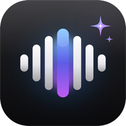

<p align="center"></p>

<h1 align="center">OpenFlo</h1>

<p align="center"><b>Free, open-source, offline voice dictation for Mac.</b><br>
Hold <code>fn</code>, talk, let go and clean, punctuated text appears in any app. 100% on-device: no cloud, no account, no subscription.</p>

<p align="center">
  <a href="https://github.com/harshkit/openflo/releases/latest"></a>
  
  
  
  <a href="LICENSE"></a>
  <a href="https://github.com/harshkit/openflo/stargazers"></a>
</p>

<p align="center"><a href="https://harshkit.github.io/openflo/">Website</a> · <a href="#install-one-line">Install</a> · <a href="#features">Features</a> · <a href="PRIVACY.md">Privacy</a></p>

---

OpenFlo is a **free, private alternative to paid AI dictation apps** like Wispr Flow, Superwhisper and Aqua Voice. It turns rambling speech into clean writing: it removes "um" and "uh", applies your self-corrections and fixes punctuation, and does it in **under a second** without anything leaving your Mac.

## Install (one line)

```bash
curl -fsSL https://raw.githubusercontent.com/harshkit/openflo/main/install.sh | bash
```

That installs everything: the local AI engine, the ~1 GB cleanup model and the app. Then allow **Microphone** and **Accessibility** when asked, and set **System Settings → Keyboard → "Press 🌐 key to" → Do Nothing**.

## Features

- 🎙️ **Hold `fn` to talk, release to paste** into any app: Slack, Gmail, Notion, VS Code, ChatGPT, anything with a text box. **Tap `fn`** for hands-free mode.
- ⚡ **Fast**: speech streams into the recognizer while you talk, so text appears **~0.6–1.0 s** after you let go (measured on an M2).
- ✨ **AI cleanup, fully local**: removes filler words and stutters, keeps only your final version ("at 5, no wait, 6" → "at 6"), adds punctuation and turns spoken lists into numbered lists. It cleans up your questions; it never answers them.
- 🗒️ **Notes**: a built-in scratchpad for thinking out loud. Use the menu bar → **New Note**, hold `fn` and speak.
- 📖 **Dictionary**: names, brands and jargon spelled your way.
- ✂️ **Snippets**: say "my calendar link" and get your full URL.
- 🎨 **Styles**: Formal, Casual or Very casual.
- 🔉 **Soft-voice boost**: automatic gain picks up quiet or distant speech.
- 📊 **History and stats**: streak, words per week, average WPM. See the raw transcript or the cleaned text.
- 🌍 **12 languages**, including English (India, US, UK, Australia), Spanish, French, German, Italian, Portuguese, Japanese, Korean and Chinese.
- 🔒 **Private by design**: no telemetry, no servers, no account. Audio is never saved. See [PRIVACY.md](PRIVACY.md).

## OpenFlo vs. cloud dictation apps

| | OpenFlo | Typical cloud dictation app |
|---|---|---|
| Price | **Free forever** | $12–15/month |
| Where your voice goes | **Stays on your Mac** | Uploaded to servers |
| Works offline | **Yes** | No |
| Account required | **No** | Yes |
| Open source | **Yes (MIT)** | No |

## How it works

```
hold fn ─► mic (16 kHz, auto gain) ─► Apple SpeechAnalyzer, streaming on the Neural Engine
release ─► transcript ─► Qwen2.5-1.5B via llama.cpp on Metal (few-shot cleanup)
        ─► dictionary + snippets ─► pasted into the app you were typing in
```

| Step | Engine | Measured time after release (M2) |
|---|---|---|
| Speech → text | Apple `SpeechAnalyzer` (on-device) | ~0.15–0.25 s |
| Cleanup | Qwen2.5-1.5B-Instruct Q4 via `llama-server` | ~0.3–0.8 s |

We benchmarked Whisper large-v3-turbo too: ~2.4 s on an M2, too slow for push-to-talk.

## Requirements

- macOS 26 (Tahoe) or newer
- Apple Silicon (M1 or newer)
- ~1 GB free disk

## Build from source

```bash
git clone https://github.com/harshkit/openflo.git && cd openflo
brew install llama.cpp
mkdir -p ~/Library/Application\ Support/OpenFlo/models && curl -L -o ~/Library/Application\ Support/OpenFlo/models/qwen2.5-1.5b-instruct-q4_k_m.gguf \
  https://huggingface.co/bartowski/Qwen2.5-1.5B-Instruct-GGUF/resolve/main/Qwen2.5-1.5B-Instruct-Q4_K_M.gguf
swift build -c release
.build/release/OpenFlo --selftest           # logic checks
.build/release/OpenFlo --file speech.wav    # run the full pipeline on a file and print timings
./build.sh              # installs ~/Applications/OpenFlo.app
```

| File | What's in it |
|---|---|
| `Sources/OpenFlo/Engine.swift` | recorder, speech session, LLM cleanup, dictionary/snippets, paste |
| `Sources/OpenFlo/Overlay.swift` | the floating pill |
| `Sources/OpenFlo/Views.swift` | Home, Notes, Dictionary, Snippets, Style, Settings |
| `Sources/OpenFlo/App.swift` | menu bar, hotkey, window |
| `Sources/OpenFlo/Store.swift` | local storage (`~/Library/Application Support/OpenFlo/`) |

## FAQ

**Is OpenFlo really free?** Yes. It's MIT-licensed, with no paid tier and no usage limits.

**Does it work without internet?** Yes, after the one-time install.

**Is it a Wispr Flow alternative?** It covers the same core workflow (hold a key, speak, get clean text) but runs entirely on your Mac. OpenFlo is an independent project and is not affiliated with Wispr or any other company.

**Text didn't paste?** Check that Accessibility is on for OpenFlo and that the 🌐 key is set to "Do Nothing". OpenFlo warns you on its Home screen when either is wrong, and the text always stays on your clipboard as a fallback.

**Windows / Android?** Android is next on the roadmap.

## Roadmap

- [ ] Android keyboard + floating bubble
- [ ] Stronger speech engine option with custom-vocabulary boosting
- [ ] Per-app tone
- [ ] Signed and notarized builds

## Contributing

PRs welcome. See [CONTRIBUTING.md](CONTRIBUTING.md), the [Code of Conduct](CODE_OF_CONDUCT.md) and the [Security Policy](SECURITY.md). If OpenFlo saves you time, a ⭐ helps other people find it.

## License

[MIT](LICENSE) © Harsh Sharma
